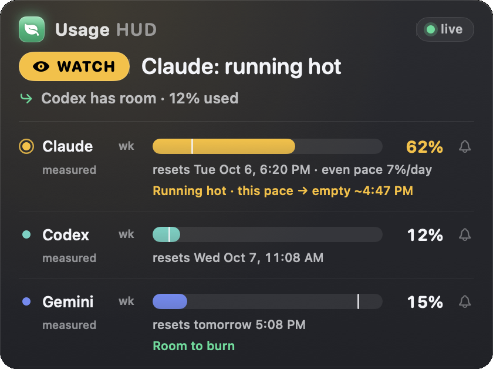

<p align="center"></p>

# Usage HUD

**Which AI subscription has room right now?** Usage HUD answers that in your Mac menu bar. One verdict for Claude, Codex, Gemini, Grok and local models: who is running hot, when it runs out at this pace, and which tool you can switch to.

**[Download for Mac (free)](https://github.com/Thalia-Bloom/usage-hud/releases/latest/download/UsageHUD.zip)** · Apple silicon and Intel · macOS 14+ · signed and notarized by Apple

Free. If it saves you a stalled afternoon, you can [leave a tip](https://hud.thaliabloom.com/#tip).

## What you see

- **One verdict.** "Claude: running hot" with the next move under it: "Codex has room · 22% used".
- **Pace, not just percent.** A tick on each bar marks how much of the window has passed. Ahead of it, the lane says when it runs dry: "this pace → empty ~4:31 PM".
- **Reset times on every lane,** and a bell that pings you when a window comes back.
- **An honest label on every number:** official, measured or estimated. Old readings say how old they are instead of passing as live.
- **Local models count too:** token totals from your Ollama logs, today and this week.

## Built on trust

- Usage stays on your Mac unless you turn on the optional public badge. No account, no analytics, no browser cookies.
- Claude numbers come from the same usage endpoint Claude Code's own `/usage` panel reads. Usage HUD never refreshes or changes your Claude Code sign-in.
- Codex numbers come from Codex's own quota and your local session logs.
- `codex-usage-doctor` tells you in plain English whether each number is reliable and why.

## Install

1. [Download the disk image](https://github.com/Thalia-Bloom/usage-hud/releases/latest/download/UsageHUD.dmg) and drag **Usage HUD** to Applications. Prefer the terminal? `curl -fsSL https://hud.thaliabloom.com/install.sh | bash`
2. Open it. It lives in the menu bar (no Dock icon).
3. The first run sets itself up: it finds your coding tools, hides the ones you don't have, and takes the first reading in about 10 seconds. No terminal. Or tell your coding agent "Usage HUD is installed, set it up" and it runs `usage-hud setup` for you.

Details and troubleshooting: [INSTALL.md](INSTALL.md).

## Requirements

- Any Mac on macOS 14 or later, Apple silicon or Intel.
- Claude Code or Codex signed in on this Mac. Nothing else to install for those two.
- Gemini (Antigravity CLI) and Grok lanes need Node.js 18 or later.
- The Local lane reads Ollama's logs.

## Usage HUD or CodexBar?

[CodexBar](https://github.com/steipete/CodexBar) is free, open source and covers far more tools. If you want every provider, use it. Usage HUD does less on purpose: it reads the few subscriptions most people code with and turns them into one calm answer about what to use next.

## FAQ

**Is it really free?** Yes. No trial, no license key, no account. Tips keep it maintained.
**Why did my weekly usage jump?** The weekly cap is separate from the 5-hour window and can move from other Claude clients on the same plan. [Why weekly usage jumped](https://hud.thaliabloom.com/why-weekly-usage-jumped/).
**Is the source available?** Yes, right here, under the MIT license. See *For developers* below.
**Support?** support@thaliabloom.com

Thalia Bloom · support@thaliabloom.com

## For developers

This is the source repository for Usage HUD: a Swift menu-bar app plus the small Node, Python and shell helpers that take each provider's reading.

### Install from source

Clone this repository, or download `UsageHUD-source.tar.gz` from the release's assets and unpack it, then:

```bash
cd usage-hud
make install         # ~/Applications/CodexUsageHUD.app, helpers in ~/.local/bin, launch agents started
```

Needs macOS 14+, Xcode or Swift toolchain, Python 3, and Node 22+ for `make test-mini`. Open the app from Applications and click **Set up** (same as the release build). Uninstall: `make uninstall` (add `REMOVE_STATE=1` to drop `~/.codex-usage-hud`).

### Build and test

```bash
swift build          # debug build of the app
make test-mini       # all non-app checks, no Swift build or install
make test            # swift test plus the same Mini check
make app             # universal release bundle in dist/CodexUsageHUD.app
./script/build_and_run.sh --verify
```

`./script/check-mini.sh` is the same check as `make test-mini` and works from
any directory. It needs Bash, Python 3 and Node 22 or later; no package install.
It runs every `script/test-*`, offline site/store tests, site shared-copy drift,
script syntax and plist validation. On macOS the signing-hygiene test also
ad-hoc signs a throwaway fixture with system tools; it needs no signing identity.
It does not build Swift, package/notarize a release, invoke a built app or agent
CLI, contact providers, configure payments, render previews or deploy. The store
suite mocks payment and network calls; this is not hosted checkout proof.
`store/scripts/check-local.mjs` checks health against a local archive fixture
and current free-download redirects. It needs no generated assets and writes
no evidence files. It does not fetch or verify a hosted release.
`make test` and `script/release_check.sh` reuse this command so their non-app
coverage stays the same. The Mac app owner runs their Swift and release gates.

Layout: `Sources/` and `Tests/` hold the app, `bin/` the helpers, `launchd/` the LaunchAgent templates, `script/` the build, release and test scripts, `Resources/bundled-helpers.txt` the list of helpers copied into the app bundle. Source distributions omit hosted services, private operations and Git history; their `SOURCE-EXPORT.json` records the exact source tree. Maintainers create the archive from a committed checkout with `make source`. Packaging exclusions are not code reductions — see [docs/LICENSE-CORE.md](docs/LICENSE-CORE.md).

Licensed under the [MIT License](LICENSE) (Copyright 2026 Bloom).

### Data contract

The app reads one JSON snapshot per provider from `~/.codex-usage-hud/`:

- `codex-usage.json`
- `claude-usage.json` (and `claude-usage-native.json`, written by the app's own Claude reader only while the `com.codexusagehud.claude-writer` job is not installed)
- `gemini-usage.json`
- `grok-usage.json`
- `local-usage.json` (optional; another local runtime can write it to override the built-in Ollama reader)

`CODEX_USAGE_HUD_STATE_DIR` points the app and every helper at another state directory. The legacy `BLOOM_USAGE_DIR` alias applies to helpers only. Each provider has its own file so writers never collide; a writer that merges a partial snapshot keeps the newer observation and any still-valid short window.

Each snapshot declares:

- `capturedAt`: when the source was checked
- `eventAt`: when the usage event actually happened
- `sourceKind`: `official_api`, `official_interactive`, `local_session_log`, `statusline_event`, or `manual`
- `confidence`: `official`, `high`, `medium`, `manual`, or `unknown`
- `confidenceNote`: a short plain-English caveat

### How each reading is produced

- **Claude.** `bloom-usage-fetch-claude-official` reads the same usage endpoint Claude Code's `/usage` panel reads (`sourceKind official_api`), using the bearer token from the Claude Code Keychain item. It is read-only: it never refreshes or rewrites the token. Claude Code's token lives about 8 hours and only Claude Code renews it, so on a Mac where Claude Code hasn't run lately the fetch sees an expired token, never sends it, and reports `token_expired` ("open Claude Code once"); it re-checks the Keychain every minute and fetches the moment Claude Code renews the token. A refused token reports `unauthorized` once per credential instead of retrying. The official reading is refreshed every 5 minutes. `bloom-usage-write-claude` merges that reading with the optional statusline tap (`bloom-usage-statusline-tap`) and the Stop-hook capture (`bloom-usage-capture.sh`).
- **Codex.** `bloom-usage-write-codex` reads `rate_limits` events from the local Codex session logs and the account quota from the installed Codex CLI app server. Session telemetry is high-confidence local data, not a billing API.
- **Gemini.** `bloom-usage-write-gemini-agy` reads Antigravity quota with `agy -p /quota --output-format json`, a print-mode command that makes no model call. It records both quota groups under `pools`, probes at most 6 times a day (`BLOOM_AGY_PROBE_DAILY_CAP`), backs off after failures, and marks the reading stale after 4.5 hours. `--force` performs one attended re-read. The older `bloom-usage-fetch-gemini` OAuth path runs only with `BLOOM_GEMINI_LEGACY_OAUTH_FETCH=1`.
- **Grok.** `bloom-usage-write-grok` reads the Grok CLI auth file for the billing endpoint and the local session logs for activity.
- **Local models.** The app itself totals evaluated-prompt and generated token counts from Ollama's retained `server*.log` files (today, rolling seven days, per model). The number is scoped to retained logs, not presented as a lifetime total.

`bloom-budget-update` runs the Codex, Gemini and Grok writers (and the Claude fetch when `BLOOM_USAGE_ALLOW_CLAUDE_BACKGROUND_FETCH=1`), then `bloom-budget-notify`, which posts a macOS notification when a provider's budget mode changes. `codex-usage-refresh` is the launchd entry point for it. All helpers use subscription logins only; there is no metered API fallback.

### Doctor

```bash
codex-usage-doctor          # plain text
codex-usage-doctor --json   # machine-readable
```

It checks state-directory permissions, Codex session visibility and the newest parseable `rate_limits` event, each provider snapshot's freshness, confidence and window contract, the Claude official status and statusline wiring, and launchd status for the app, the writers and the refresh job. Exit 0 is clean, 2 means warnings, 1 means a failure. It never prints prompts, messages, secrets or raw session contents.

`make install` renders launchd templates from `launchd/` with your home directory and starts `com.codexusagehud.app`, `.codex-writer`, `.claude-writer`, `.grok-writer` and `.refresh`. The old `com.codexusagehud.live-scraper` job was retired; `make claude-scraper-stop` removes it from older installs. `make claude-refresh-now` runs a foreground one-shot Claude refresh.

`~/.local/bin/bloom-node` is a shim that finds a working `node` (`$BLOOM_NODE_BIN`, `PATH`, Homebrew, nvm, Volta). Point `~/.claude/settings.json` at it so the statusline tap and the optional budget-guard hook keep working in sessions whose `PATH` has no `node`:

```json
"statusLine": {
  "type": "command",
  "command": "~/.local/bin/bloom-node ~/.local/bin/bloom-usage-statusline-tap"
}
```

```bash
make uninstall                 # keeps state
REMOVE_STATE=1 make uninstall  # removes ~/.codex-usage-hud too
```

### Release

```bash
./script/release_check.sh      # full local gate: swift test, script tests, lint, package
make package                   # ad-hoc signed zip for local testing
DEVELOPER_ID_APPLICATION="Developer ID Application: ..." \
NOTARYTOOL_PROFILE="codex-usage-hud" \
./script/package_release.sh    # signed, notarized, stapled; updates the Sparkle appcast
```

Without those variables the package is ad-hoc signed and notarization is skipped.

A Developer ID–signed preview can be packaged with `DEVELOPER_ID_APPLICATION=... ./script/package_release.sh --skip-notary`. Label it as **not notarized**, publish it only as a GitHub prerelease, and leave the stable download and site appcast unchanged. macOS may block it on a new Mac. A strict signature pass does not prove Gatekeeper acceptance.

### Support

Use [support@thaliabloom.com](mailto:support@thaliabloom.com) or public [GitHub issues](https://github.com/Thalia-Bloom/usage-hud/issues); keep private account details out of public threads. The app Help tab runs diagnostics and can open a reviewed email report; nothing is sent automatically.
